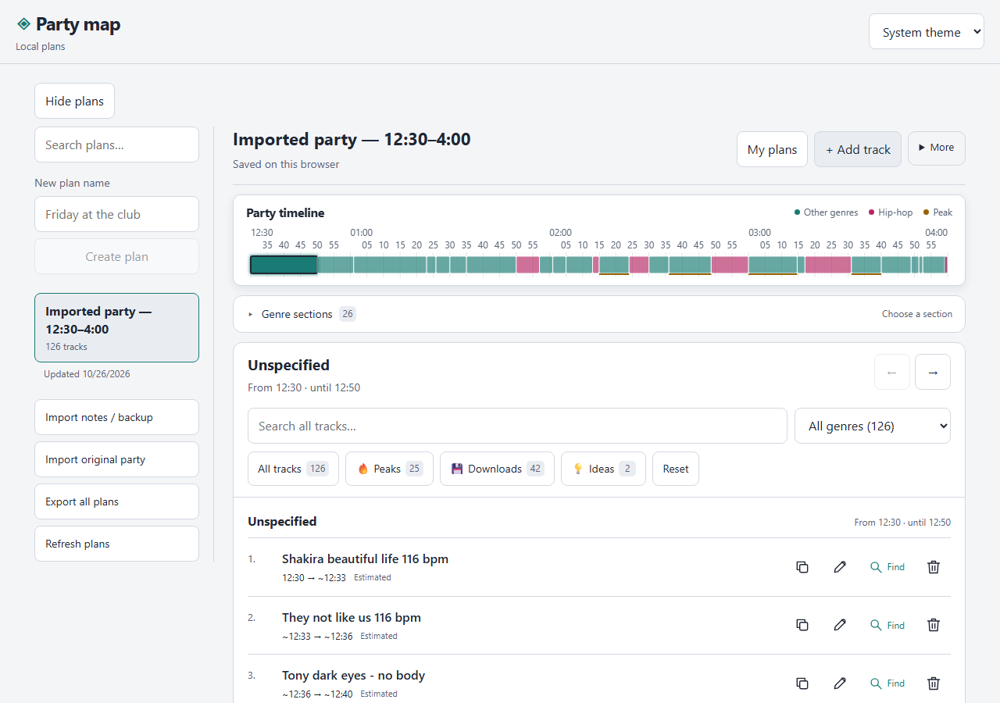

# Party Map — DJ timeline

A track-first DJ planner built with Astro and Svelte. Open a plan, see the whole party timeline, then inspect its tracks. The same source builds a website and downloadable HTML editions.

## Features

- Empty initial workspace with searchable My plans, desktop rail/collapse and mobile plan switcher.
- Compact **Add track** dialog: name, manual genre with existing-genre suggestions, current-time default you can override, and optional ending.
- Automatic contiguous genre sections. No manual Add section step. An explicit ending before the next track leaves a real blank gap; omitted endings follow the next known start.
- Compact sticky ruler stays visible above tracks. Every genre interval is clickable; selection shows whole-hour anchors and the selected start/end times, then scrolls to its tracks. All tracks scrolling highlights the visible genre section. Full scale restores five-minute desktop / ten-minute phone labels and stays enabled while scrolling. Start/end labels sit beside the highlighted interval. Estimated boundaries retain ~ and unknown endings stay explicit.
- Tracks are numbered in plan order and grouped into continuous chapters: keep scrolling to reach the next genre section while the sticky ruler follows. Filtering preserves those plan-wide numbers. Peaks, Downloads, Ideas and genre filters show whole-plan counts.
- Expand Genre sections for large controls with visible start times/ranges and track counts. The compact opening brings tracks closer; mobile My plans opens the list directly. Copy/edit/Find Google search/remove controls retain accessible names, and Full scale has a 44px target. Both themes keep readable status tags.
- Supabase email/password login and private plans. Committed edits save automatically with revisions, stable retry IDs and recoverable conflict copies.
- Cached complete plans and pending changes reopen offline in the connected HTML. Reconnect retries under the original account; denied/quota-limited storage is reported honestly.
- Original pasted/.txt notes import with preview. **Import original party** creates a new plan from the 126-track set.
- JSON backup/export of one plan or all own plans, including pending drafts; validated restore creates new private plans. No auth credentials or other accounts are included.
- Dark, Light and System themes, multilingual names, keyboard/touch controls and a masked creation dialog.

## Develop

Use Node 22.12+ and pnpm 12.11.2 (pinned). Tested with Node 24.14.1.

~~~sh
pnpm install --frozen-lockfile
pnpm dev
~~~

Without a global pnpm installation, prefix commands with npm exec --yes --package=pnpm@12.11.2 -- pnpm.

## Build and download

The generated `dist/` folder is tracked in Git so the downloadable HTML files and static website are available from this repository. Rebuild and commit the updated outputs with source changes. Connected builds contain public Supabase configuration; passwords, sessions and private keys must never be included.

~~~sh
pnpm build:site
pnpm build:offline
pnpm build:connected
~~~

- dist/site/ — static website; serve the entire directory.
- dist/party-map.html — local named plans, no login or automatic network requests. Open directly in Chrome or send the single file.
- dist/party-map-connected.html — private Supabase plans, inline scripts/styles/SDK and public configuration. Open directly in Chrome; internet is needed for login and cloud synchronization. Previously cached plans work offline.

Connected builds need .env.local copied from .env.example with the project URL and public publishable key. Never bundle secret/service-role keys, passwords or JWT private keys. Independent builds preserve the other output. Google search intentionally needs internet. Hosted page reload while offline is not supported without a service worker; use the downloadable edition for offline reopening.

## Supabase setup

Follow [setup instructions](docs/supabase-setup.md). Apply additive migrations 001/003/004/005 in their documented order; existing projects must not rerun their applied initial migrations. The user confirmed 005 succeeded. Migration [005](supabase/migrations/202610120005_track_timing.sql) validates track-first v2, retains v1 imports, prevents old-client downgrades, and exposes only the current user's genre vocabulary.

Email provider/signup are enabled and confirmation is off for the selected SMTP-free setup. Email ownership is unverified. Manual administrator recovery is supported outside the app; no privileged reset key is embedded. Cloud access remains owner-scoped through RLS and restricted RPCs.

On 2026-10-12 the original set was created as **Imported party — 00:30–04:00** in the signed-in user's Supabase account. After reload/open, 126 tracks, 26 sections, 42 download flags, 25 peaks and 2 ideas were verified. An own-account backup with two plans (126 tracks and an empty plan) was downloaded and validated. No private backup/session data is committed.

## Original notes format

~~~text
12:30
(Afro tech)
First track ---
Second track ///
1:50
(Hip hop) הפגזות
Another track --
Track title (remix)
~~~

Times/genres persist until replaced. Only a full parenthesized line changes genre; parentheses in track names remain. --/--- marks downloads; /// marks ideas. Standalone Hebrew peak markers persist until the next genre, while inline markers tag only that track. Hebrew, Russian and English names remain intact.

Legacy notes retain sequential 12-hour rollover without invented AM/PM, dates, exact per-track start times or final endings. New authored tracks use 24-hour times and explicit day offsets for overnight plans. Editing an imported untimed track can preserve its source timing by leaving the exact start blank. Before adding current-time tracks to an ambiguous imported twelve-hour plan, choose its morning/night or afternoon/evening clock once. Original marker wording is retained in the document. Estimates divide each recorded time period by its track count; ~ marks inferred values and an unknown final ending remains unknown.

Raw notes limits: 500,000 characters / 500 KB in the selected-plan importer. Account backups support 1–100 plans and 20 MB; document limits remain 10,000 events and 2 MB. JSON is the lossless backup format for optional endings; the original text syntax cannot express every new field.

## Storage and synchronization

Browser-local plan/cache data is scoped by project, account and plan. LocalStorage is the current cache implementation; quotas, denial, clearing storage and changing browser/origin/file location can affect recovery. It is not encrypted. Logout removes visible private state; another account cannot replay a retained queue. Closed HTML does not synchronize in the background.

The active plan refreshes every 15 seconds and on focus; reconnect/focus retries retained saves after online identity validation. This polling fallback needs no Realtime publication. Private push notifications remain future work; no two-second cross-device guarantee is claimed.

## Verify

~~~sh
pnpm check
pnpm test
pnpm build:site
pnpm build:offline
pnpm build:connected
pnpm test:e2e
node scripts/check-reproducible.mjs
~~~

See [verification](docs/verification.md) for current counts and evidence. Browser cloud tests intercept synthetic accounts; local PostgreSQL tests cover ownership, additive migration, validation, retries and revision conflicts. These are distinguished from the actual account import/reload/export verified above. Hosted cross-account API isolation and native screen-reader review remain release checks.

## Project documents

- [Authoritative current state](docs/current-state.md), [decisions](docs/decisions.md), and [engineering workflow](docs/agentic-workflow.md)
- Local workflow gate: `node scripts/workflow/runner.mjs gate TASK-ID tooling`; see [gate categories and limitations](docs/workflow-gates.md).

- [Reusable eight-pillar architecture starter](AGENTIC-ARCHITECTURE-STARTER.md)
- [Workflow adoption plan](docs/agentic-adoption-plan.md) and [adoption backlog](docs/agentic-adoption-backlog.md) — E23–E27 evidence and capability limits
- [Track-first requirements](docs/track-first-requirements.md)
- [Implementation plan](plan.md)
- [Prioritized backlog](backlog.md)
- [Project instructions](AGENTS.md)
- [Recommended skills](SKILLS.md) and [role prompts](SUBAGENTS.md)

Active source is src/. Historical HTML iterations are preserved. Astro owns the page shell; shared Svelte components own interaction; pure parsing/timing, account adapters and synchronization remain separate. Repository: [z0523323147/djtimeline](https://github.com/z0523323147/djtimeline). No public hosted deployment or license is configured.
