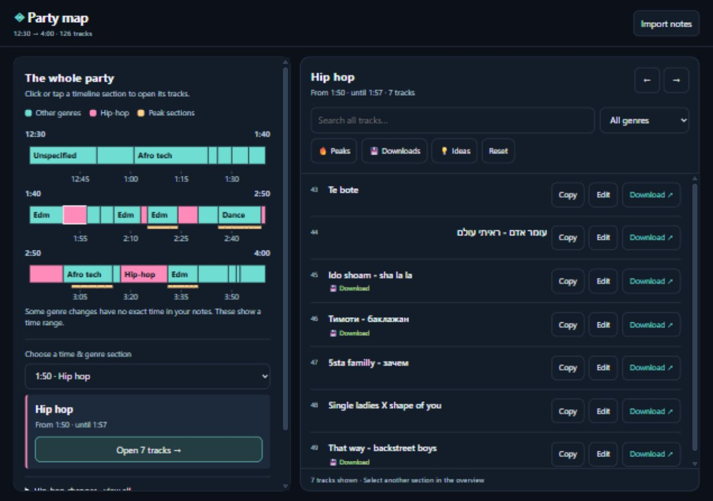

# Party Map — DJ Set Timeline

A standalone DJ set planner that turns rough text notes into an interactive party timeline. See the flow of the night, inspect genre sections, and prepare your track library.



## Run it

Open **[dj-set-timeline-v2.html](dj-set-timeline-v2.html)** in a modern browser. No build step or dependency installation is required.

For a localhost preview, run this command from the project folder with Node.js installed:

```powershell
node -e 'const http=require("http"),fs=require("fs");http.createServer((req,res)=>{res.setHeader("Content-Type","text/html; charset=utf-8");res.end(fs.readFileSync("dj-set-timeline-v2.html"));}).listen(4173,"127.0.0.1",()=>console.log("http://127.0.0.1:4173"));'
```

Open `http://127.0.0.1:4173` and stop the preview with Ctrl+C. If that port is already occupied, choose another unused port. This small preview server serves the app for every request; it is not a deployment server.

The app works offline after opening. **Download** opens a Google search and requires an internet connection. Clipboard and storage availability depend on the browser; localhost and directly opened files can behave differently.

## What you can do

- See the party across three time bands, with hip-hop in pink and peaks marked in amber.
- Click or tap a timeline section to open its tracks; Enter and Space also work.
- Browse exact genres, source time markers, and hip-hop entry/exit changes.
- Search the whole set and combine genre, peak, download, and idea filters.
- Copy a track name, correct it, and keep corrections locally when storage is available.
- Use **Download** to search Google for the current track name plus `download`; it does not download an audio file itself.
- Import a new set by pasting notes or choosing a `.txt` file.
- Use overview/track panes on desktop and dedicated **The party** / **Tracks** views on mobile.

## Notes format

```text
12:30
(Afro tech)
First track ---
Second track ///
1:50
(Hip hop) הפגזות
Another track --
Track title (remix)
```

- **Times:** a whole line such as `12:30` or `1:50`. Subsequent tracks inherit that time until another marker appears.
- **Genres:** a whole parenthesized line, optionally followed by `הפגזות`. Genre state persists across time markers. Parentheses inside a track name remain part of that name.
- **Downloads:** two or more consecutive hyphens, such as `--` or `---`.
- **Ideas:** `///`.
- **Peaks:** a standalone `הפגזות` starts a peak section. A genre declaration resets that state unless it also contains the peak marker. An inline peak marker affects only its track.
- Blank and marker-only lines do not create tracks. Displayed names have marker strings removed.

Times follow the order of the notes, including a sequential 12-hour rollover such as `12:30 → 1:01`. The app does not assign AM/PM. If a genre changes between two recorded times, it displays a range; positions inside that range are approximate diagram placement, not precise playback times. When a genre declaration precedes a new time marker and its first track follows that marker, the section begins at that track's time.

**Import notes** replaces the active set after you select **Use these notes**. Cancel leaves the current set intact. File imports are limited to 500,000 bytes; pasted notes are limited to 500,000 JavaScript string units. Notes must contain at least one track. A single time marker or no time markers is accepted, with a simplified browsing view.

## Local data

Imported notes and title corrections are saved in browser local storage when available. They are scoped to the browser and origin: another browser, port, hosted URL, or file context may have different saved data. This is local persistence, with no account, server database, or cross-device sync.

Importing and editing do not rewrite the HTML file. If saving fails, changes remain available for the session and the UI reports the limitation. Google receives a track-name query only when its search link is opened.

## Project files

- `dj-set-timeline-v2.html` — active application; its internal version comment is v3.0.
- `dj-set-timeline.html`, `dj-set-timeline2.html`, `dj-set-timeline-v1.html` — historical iterations.
- `party-map-preview.png` — desktop screenshot.
- `party-map-mobile.png` — mobile screenshot.
- [AGENTS.md](AGENTS.md) — project instructions for development agents.
- [plan.md](plan.md) — milestones, current baseline, and decisions.
- [backlog.md](backlog.md) — epics, stories, subtasks, priorities, and acceptance criteria.
- [SKILLS.md](SKILLS.md) — five recommended reusable skill workflows.
- [SUBAGENTS.md](SUBAGENTS.md) — five recommended specialist roles.
- `package.json` — executable build/validation scripts, compatible with pnpm.
- `scripts/` — offline packaging, structural validation, and six Node tests.
- `dist/party-map.html` — generated standalone offline artifact (ignored by Git).

The skill and subagent documents are recommendations. They do not install skills or register runtime agents.

## Development and validation

The current stack is semantic HTML, inline CSS, modern JavaScript, SVG, browser clipboard APIs, file reading, and local storage. Data passes through parsing, model construction, filtering, persistence, and rendering. Imported titles are rendered as text.

Six automated packaging tests now exist; parser/browser regression automation and CI are still planned. With Node.js 22+ and pnpm installed:

```sh
pnpm build:offline
pnpm check:offline
pnpm test
```

The build currently validates and copies the existing self-contained app to `dist/party-map.html`; it requires no framework dependencies. It checks embedded scripts and rejects several external asset patterns. These structural checks do not audit runtime network requests or replace browser tests. The scripts were run successfully through npm on the development machine because pnpm is not installed there.

Astro routes, Svelte page views, a shared offline IIFE entry, and Linear-inspired design refinements are the next migration, detailed in [plan.md](plan.md) and E7/E8 in [backlog.md](backlog.md). Framework dependencies and routes have not yet been added; the current build is not an Astro compilation.

A separate basic syntax check, with Node.js installed, is:

```powershell
node -e 'const fs=require("fs"),vm=require("vm");const html=fs.readFileSync("dj-set-timeline-v2.html","utf8");new vm.Script(html.match(/<script>([\s\S]*?)<\/script>/)[1]);console.log("JavaScript syntax OK");'
```

Syntax checking does not verify behavior. For changes, exercise timeline click/tap/keyboard selection, mixed-language text, combined filters, import/cancel/reload, editing, copy, and Google links. Check phone and desktop layouts, plus storage failure and direct-file behavior when relevant.

The bundled set currently contains **126 tracks, 25 time blocks, and 26 genre sections**, including 42 download choices, 25 peak tracks, and 2 ideas. Development checks included the in-app browser at 390×844 and 1280×900; other browsers have not been formally certified.

## Current limitations

- The final 4:00 section has no inferred duration and is currently omitted from chart segments; it remains accessible through the section picker and time navigation.
- Short timeline sections can be narrower than a comfortable phone tap target. The section picker provides an alternative.
- Corrected-set export and restoring the example set through the UI are planned, not implemented.
- Browser-local data can be cleared or become unavailable; no portable backup workflow exists yet.
- The chart uses a simplified color scheme; detailed genre names appear through section browsing and labels where space permits.

See [backlog.md](backlog.md) for the prioritized work addressing these limits.

## GitHub sharing

The repository is [z0523323147/djtimeline](https://github.com/z0523323147/djtimeline). No hosted deployment is configured. The active HTML can be shared as a standalone file or served by a static host. A GitHub Pages entry point and release naming are planned in E5-S2.

Contributions should preserve the single-file offline deliverable and the overview-first workflow while moving development into shared Astro/Svelte source. Start with [AGENTS.md](AGENTS.md) and select a story from the backlog. No license file has been selected for this project yet.
